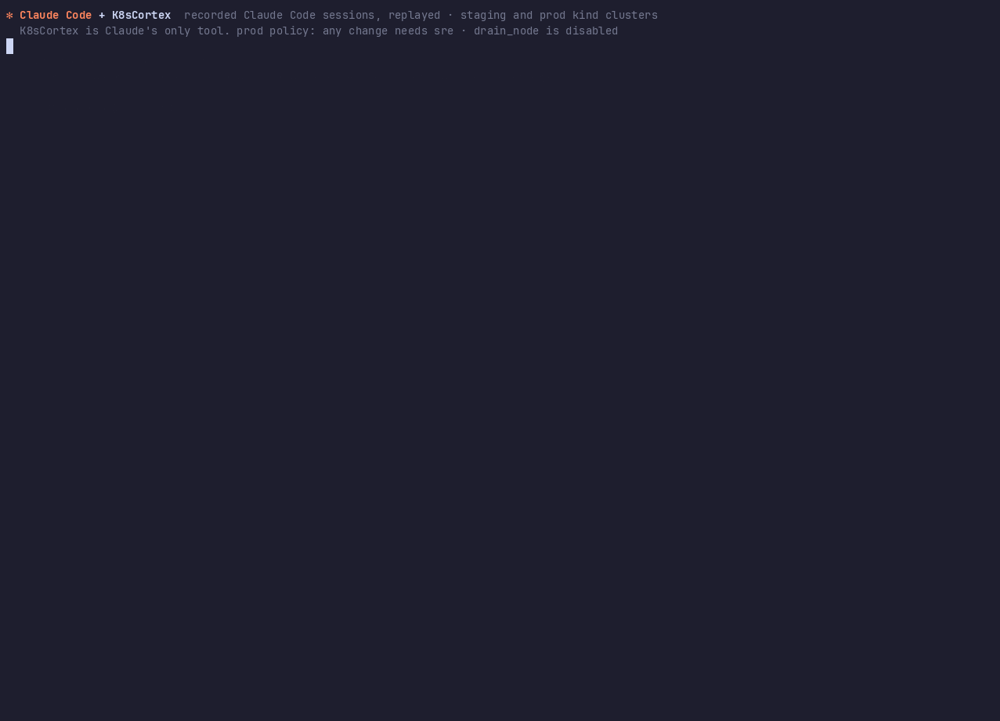

# K8sCortex — Kubernetes MCP Server

[](https://github.com/apatilgtn/k8scortex-mcp/actions/workflows/ci.yml)
[](https://www.npmjs.com/package/k8scortex-mcp)
[](https://smithery.ai/server/apatil0431/k8scortex-mcp)
[](LICENSE)

> **Give your AI agents Kubernetes access your security team will sign off on.** K8sCortex is one governed MCP gateway for GKE, EKS, AKS, OpenShift and local clusters: SSO on every request, role tiers, per-cluster policies, dry-run by default, and an audit log of who asked for what.

Most Kubernetes MCP servers hand an agent your kubeconfig. K8sCortex sits in between: it decides, per person and per cluster, which of its 75 tools may run, and records every call. Clusters from different clouds live in one registry, with credentials minted on demand.



<sub>A real Claude Code session with K8sCortex as its only tool, on a throwaway prod cluster: the developer is denied the rollback, the release manager is blocked by the prod policy, the SRE fixes it.
**[Watch all five scenarios (97 s)](docs/demo/claude/claude-demo.mp4)**: incident, release drift, flash-sale scaling, password rotation, node maintenance. [How it was recorded](docs/demo/README.md).</sub>

---

## Features

- **Curated multi-domain toolset** across workload, deployment, configuration, observability, jobs, networking, GitOps, cluster admin, and generic read paths
- **Multi-cloud cluster providers** — kubeconfig contexts, Amazon EKS (IAM/IRSA), Google GKE (Workload Identity) and Azure Key Vault, mixed in one registry
- **Multi-cluster routing** — target any registered cluster with a single `cluster` parameter; writes require an explicit cluster when several are registered
- **Any OIDC identity provider** (Entra ID, Okta, Cognito, Keycloak, Google) with per-tool RBAC (5-tier role hierarchy) and per-cluster policies
- **Structured audit logging** — every tool call recorded with caller identity, arguments, and outcome
- **Dual transport** — SSE/HTTP for programmatic clients + stdio for Claude Desktop
- **Short-lived credentials** — EKS and GKE tokens are minted on demand and cached only until they expire
- **Dry-run safety** — destructive tools default to simulation mode
- **Generic read coverage** — list/get support for resources outside curated write paths to avoid troubleshooting dead-ends

## Install

### Claude Desktop, Claude Code, Cursor and other MCP clients (stdio)

Requires Node.js 22+ and a working kubeconfig. Add to your client's MCP configuration (Claude Desktop: `claude_desktop_config.json`):

```json
{
  "mcpServers": {
    "k8scortex": {
      "command": "npx",
      "args": ["-y", "k8scortex-mcp"],
      "env": { "K8SCORTEX_STDIO_ROLES": "developer" }
    }
  }
}
```

`developer` gives a read-only session; remove it for the full toolset. With Claude Code: `claude mcp add k8scortex -- npx -y k8scortex-mcp`.

### As a shared service for a team (HTTP + OIDC)

With the [Helm chart](charts/k8scortex) (read-only RBAC by default; see the chart README for writes and more clouds):

```bash
helm install k8scortex ./charts/k8scortex -n platform-mcp --create-namespace \
  --set auth.oidc.issuer=https://login.example.com --set auth.oidc.audience=k8scortex
```

Plain manifests rendered from the chart are in [`kubernetes/`](kubernetes/). Or run the image directly:

```bash
docker run -p 3000:3000 \
  -e OIDC_ISSUER=https://login.example.com -e OIDC_AUDIENCE=k8scortex \
  -e CLUSTERS_CONFIG=/config/clusters.json -v "$PWD/clusters.json:/config/clusters.json:ro" \
  ghcr.io/apatilgtn/k8scortex-mcp:latest
```

Run it in a management cluster with Workload Identity / IRSA / managed identity for the cloud providers, expose `/mcp` internally, and ship the audit log to your SIEM. See [Multi-cloud setup](#multi-cloud-setup) and [Authentication](#authentication).

## Develop

### Prerequisites

- Node.js ≥ 22 (the GKE provider's `google-auth-library` and the `jose` dependency of `jwks-rsa` need it)
- A Kubernetes cluster (minikube, kind, GKE, EKS, AKS or OpenShift)
- `kubectl` configured with a valid context

### Install & Run

```bash
# Clone
git clone https://github.com/apatilgtn/k8scortex-mcp.git
cd k8scortex-mcp

# Install
npm install

# Build
npm run build

# Run (local dev mode — auth bypassed)
DISABLE_AUTH=true PORT=3001 npm run dev
```

### Connect with MCP Inspector

```bash
npx @modelcontextprotocol/inspector sse http://localhost:3001/mcp
```

### Connect Claude Desktop to a local build

Point the client at your build instead of the npm package:

```json
{
  "mcpServers": {
    "k8scortex": {
      "command": "node",
      "args": ["<path-to>/k8scortex-mcp/dist/stdio.js"]
    }
  }
}
```

Restart Claude Desktop. Ask: *"List all pods in the default namespace"*.

Every context in your kubeconfig is available as a cluster, so you can ask *"Compare the web app's ArgoCD revision between kind-dev and prod-eks"*. Set `K8SCORTEX_STDIO_ROLES=developer` to give the local session read-only tools.

---

## Multi-cloud setup

K8sCortex picks its cluster source from the environment:

| Source | When | Clusters |
|---|---|---|
| `CLUSTERS_CONFIG=/path/clusters.json` | Set | Clusters listed in the file, across any providers |
| Azure Key Vault | `AZURE_KEYVAULT_URI` set | The Key Vault cluster index |
| kubeconfig | Otherwise (or `USE_LOCAL_KUBECONFIG=true`) | Every context in `KUBECONFIG` / `~/.kube/config`, or the in-cluster service account |

`DEFAULT_CLUSTER` chooses the cluster used when a tool call names none. Read-only tools fall back to it; mutating tools require an explicit `cluster` whenever more than one cluster is registered.

### Cluster registry file

```json
{
  "defaultCluster": "dev",
  "clusters": [
    { "name": "dev", "provider": "kubeconfig", "context": "kind-dev", "labels": { "env": "dev" } },
    { "name": "prod-eks", "provider": "eks", "region": "us-east-1", "eksClusterName": "prod",
      "roleArn": "arn:aws:iam::111122223333:role/k8scortex", "labels": { "env": "prod" } },
    { "name": "prod-gke", "provider": "gke", "project": "my-project", "location": "us-central1",
      "gkeClusterName": "prod", "labels": { "env": "prod" } },
    { "name": "prod-aks", "provider": "azure-keyvault", "cloud": "aks", "region": "australiaeast",
      "keyVaultUri": "https://my-vault.vault.azure.net", "labels": { "env": "prod" } }
  ],
  "policies": [
    { "labels": { "env": "prod" }, "minRole": "sre", "appliesTo": "mutating" },
    { "match": "prod-*", "denyTools": ["drain_node", "delete_namespace"] }
  ]
}
```

| Provider | Credentials | Fields |
|---|---|---|
| `kubeconfig` | Whatever the context uses, including exec plugins (`aws eks get-token`, `gke-gcloud-auth-plugin`, `kubelogin`) | `context`, `kubeconfigPath` |
| `eks` | Default AWS chain (IRSA, EKS Pod Identity, instance profile, env, SSO), optionally assuming `roleArn`; tokens are presigned STS URLs refreshed every 14 minutes | `region`, `eksClusterName`, `roleArn` |
| `gke` | Application Default Credentials (GKE Workload Identity, service account, `gcloud auth application-default login`) | `project`, `location`, `gkeClusterName`, `usePrivateEndpoint` |
| `azure-keyvault` | Managed identity; base64 kubeconfig in secret `kubeconfig-<name>` (or `secretName`) | `keyVaultUri`, `secretName` |

The EKS and GKE providers use optional dependencies (`@aws-sdk/client-eks`, `@aws-sdk/credential-providers`, `@smithy/signature-v4`, `@aws-crypto/sha256-js`, `google-auth-library`) that npm installs by default. The identity needs `eks:DescribeCluster` plus an EKS access entry, or `container.clusters.get` plus Kubernetes RBAC on GKE.

### Per-cluster policies

Policies match clusters by name glob (`match`) and/or `labels`, and can only **tighten** the global role table:

- `minRole` raises the role required on matching clusters (`appliesTo: "mutating"` limits it to write tools)
- `denyTools` disables tools for everyone on matching clusters

`compare_clusters` is checked against both clusters it reads.

### Authentication

HTTP mode refuses to start unless an identity provider is configured (or `DISABLE_AUTH=true`):

| Variable | Description |
|---|---|
| `OIDC_ISSUER` | Issuer URL(s), comma-separated; JWKS is discovered from `/.well-known/openid-configuration` |
| `OIDC_AUDIENCE` | Expected audience(s), comma-separated |
| `OIDC_JWKS_URI` | Optional JWKS URL override |
| `OIDC_ROLES_CLAIM` | Claim holding roles/groups (default `roles`; e.g. `groups`, `cognito:groups`, `realm_access.roles`) |
| `OIDC_ROLE_MAP` | JSON map from IdP group names to K8sCortex roles, e.g. `{"k8s-admins":"platform-engineer"}` |
| `ENTRA_TENANT_ID` / `ENTRA_CLIENT_ID` | Shorthand for Entra ID (sets issuer, audience and JWKS) |

---

## Tools

K8sCortex intentionally keeps writes curated and governed, while allowing flexible read access for diagnostics.

| Domain | Tool | Description |
|---|---|---|
| Workload | `list_pods` | List pods with status and IP |
| Workload | `get_pod_logs` | Fetch container logs |
| Workload | `describe_deployment` | Full deployment spec |
| Workload | `list_statefulsets` | List StatefulSets with rollout status |
| Workload | `describe_statefulset` | Detailed StatefulSet spec/status |
| Workload | `list_daemonsets` | List DaemonSets with scheduling status |
| Workload | `describe_daemonset` | Detailed DaemonSet spec/status |
| Workload | `list_nodes` | Cluster nodes with Ready status |
| Deploy | `scale_deployment` | Scale replicas (dry-run default) |
| Deploy | `restart_pod` | Delete pod to trigger restart |
| Config | `get_configmap` | Read ConfigMap data |
| Config | `describe_namespace_quota` | Resource quota usage |
| Config | `list_events` | Recent namespace events |
| Config | `list_persistent_volume_claims` | PVC status, bound volume, storage class, capacity |
| Config | `get_effective_permissions` | ServiceAccount SubjectAccessReview matrix |
| Generic Read | `list_k8s_resources` | Generic list for arbitrary resource kinds |
| Generic Read | `get_k8s_resource` | Generic get for arbitrary resource kinds |
| Observe | `get_hpa_status` | HPA metrics and scaling |
| Observe | `list_warning_events` | Warning events for triage |
| Observe | `get_node_pressure` | Node memory/disk/PID pressure |
| Multi | `list_clusters` | All registered clusters |
| Multi | `get_cluster_info` | Node count, versions, architecture |

For the evolving full catalog, see [docs/developer-guide.md](docs/developer-guide.md).

---

## Managed Risk

The largest functional risk in Kubernetes MCP is dead-end visibility on non-curated resources (for example StatefulSets, DaemonSets, PVCs, or CRDs). K8sCortex addresses this by combining:

- **Governed writes**: high-impact operations remain explicit, role-gated, and often dry-run by default.
- **Flexible reads**: generic read tools cover arbitrary resource kinds for diagnostics.

This keeps the governance posture strong while preserving practical troubleshooting coverage.

---

## Scope Boundaries (v1)

K8sCortex is designed as a governed platform interface, not an unrestricted Kubernetes super-client.

- **Generic write for any resource**: intentionally out of scope in v1. Writes are curated and role-gated by design.
- **Pod exec interactive sessions**: intentionally out of scope in v1. This requires stronger session controls and command-level auditing that are planned for a later version.

---

## Architecture

```
Claude / IDE agents / CI-CD
        │
        ▼
┌──────────────────────────────┐
│     K8sCortex MCP Server     │
│  OIDC → RBAC → Policy → Tool │
│            → Audit           │
│         │                    │
│     Cluster Registry         │
│ kubeconfig│EKS│GKE│KeyVault  │
└──────────┬───────────────────┘
           │
    ┌──────┼──────┬──────┐
    ▼      ▼      ▼      ▼
   AKS    EKS    GKE  OpenShift / local
```

---

## Security

- **Authentication**: OIDC tokens (issuer, audience and signature) validated on every request; sessions are bound to the user that created them
- **Authorization**: Role-based tool access (`developer` → `platform-engineer`), tightened per cluster by policies
- **Audit**: JSON-structured log per invocation with user, tool, cluster, provider and outcome; secret values are redacted
- **Network**: ClusterIP only — no public endpoint
- **Credentials**: Short-lived EKS/GKE tokens or Key Vault kubeconfigs, cached only until expiry

---

## Project Structure

```
src/
├── index.ts              # HTTP server (StreamableHTTP + SSE)
├── stdio.ts              # Stdio entry point (Claude Desktop)
├── server.ts             # Tool registry, authorization and dispatch
├── auth.ts               # OIDC middleware
├── roles.ts              # RBAC role hierarchy and per-cluster policies
├── audit.ts              # Audit logger with redaction
├── context.ts            # AsyncLocalStorage user context
├── cluster-store.ts      # Per-cluster K8s client cache
├── clusters/
│   ├── registry.ts       # Cluster registry and CLUSTERS_CONFIG loader
│   ├── kubeconfig.ts     # kubeconfig contexts provider
│   ├── eks.ts            # Amazon EKS provider
│   ├── gke.ts            # Google GKE provider
│   └── azure-keyvault.ts # Azure Key Vault provider
└── tools/                # 75 tools in 14 modules: workload, deployment, configuration,
                          # config_management, workload_creation, jobs, network, observability,
                          # resource_intelligence, cloud_awareness, cluster_admin, gitops,
                          # generic_read, multicluster

tests/
├── *.test.ts             # Unit and auth/audit integration tests (vitest)
└── e2e/
    ├── kwok/             # 164-scenario matrix on two simulated clusters (runs in CI)
    └── gke/              # Every tool, both GKE providers and policies on a real GKE cluster

charts/k8scortex/         # Helm chart for the shared HTTP service (tested on kind in CI)
kubernetes/               # The chart rendered to plain manifests, with example values
Dockerfile                # Image published to ghcr.io/apatilgtn/k8scortex-mcp

docs/
├── developer-guide.md    # End-user documentation
├── operator-runbook.md   # Platform team operations
└── slos.md               # Service level objectives
```

---

## Testing

Every push runs lint, typecheck, unit tests, auth/audit integration tests and a 164-scenario end-to-end matrix on two [KWOK](https://kwok.sigs.k8s.io/) clusters (GKE-like and EKS-like). Releases are also checked against a real GKE cluster with [`npm run test:e2e:gke`](tests/e2e/gke/README.md): v1.1.1 passed 100/100 on GKE 1.36, and that run found the three GKE-specific bugs fixed in the [changelog](CHANGELOG.md).

---

## Documentation

- **[Developer Guide](docs/developer-guide.md)** — How to connect, available tools, example queries
- **[Operator Runbook](docs/operator-runbook.md)** — Deploy, upgrade, rotate credentials, incident response
- **[SLOs](docs/slos.md)** — Availability, latency, and alerting targets
- **[Changelog](CHANGELOG.md)**

## Contributing

Issues and pull requests are welcome. Run `npm run release:gate` before opening a PR; new tools need a role in `src/roles.ts` and a case in the KWOK matrix.

## License

[MIT](LICENSE)
